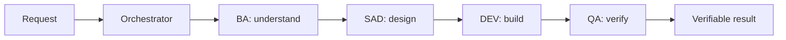
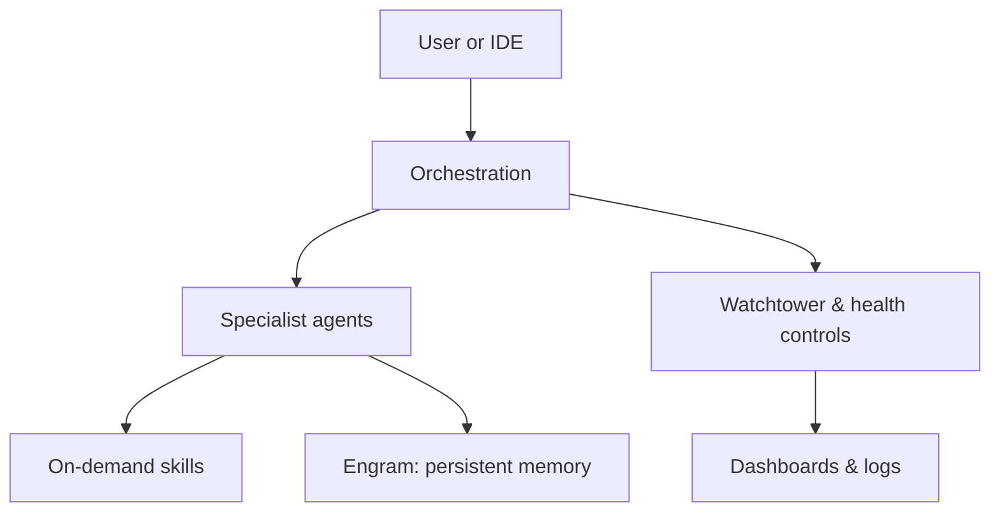

# GentleVanguard

**The local-first governance, memory and verification layer for AI-assisted engineering teams.**

**Version 4.3.0** (MIT) · [Company website](https://gentlevanguard.github.io/) ·
[Academy](https://gentlevanguard.github.io/academy/) · [Demo suite](demos/README.md)

## The problem it solves

AI-assisted development scales badly:

- **Context is lost.** Every task starts from zero — decisions, constraints and prior sessions
  vanish between restarts and tool switches.
- **Quality is inconsistent.** The same request produces different results depending on the model,
  the prompt and the day. Nobody re-checks the guardrails while agents write code fast.
- **Architecture drifts.** Fast AI output makes design decisions that nobody reviewed, and debt
  accumulates invisibly.
- **Costs are invisible.** Token spend, retries and rework disappear inside chat scrollback.

Cursor, Claude Code, Codex and Copilot write the code. **GentleVanguard adds what they don't have**:
orchestration, memory, verification and observability around that work — while it stays completely
local-first.

## What it adds

| Capability                        | What you get                                                                                                                                                                       |
| --------------------------------- | ---------------------------------------------------------------------------------------------------------------------------------------------------------------------------------- |
| **Work orchestration**            | Each request routes to a specialist agent (analysis, design, build, QA, ops, governance). Inline work is the default; formal spec phases are opt-in for changes that warrant them. |
| **Persistent engineering memory** | Decisions, context and session history survive restarts and tool switches. A new session resumes where the last one ended.                                                         |
| **Verification & governance**     | 154 automated health checks, independent review gates, audit trails and delegation rules — quality is enforced, not assumed.                                                       |
| **Observability**                 | Sessions, tokens, costs, errors and outcomes become visible, measurable data instead of scrollback.                                                                                |

## See it in action

The [demo suite](demos/README.md) contains 8 audience-oriented walkthroughs with run steps and
expected output:

| Demo                                                                          | Audience        | Focus                              |
| ----------------------------------------------------------------------------- | --------------- | ---------------------------------- |
| [01 — Developer onboarding](demos/01-dev-developer-onboarding/DEMO.md)        | Dev team        | First session, hooks, CLI basics   |
| [03 — Memory & continuity](demos/03-dev-engram-memory-and-continuity/DEMO.md) | Dev team        | Persistent memory, context handoff |
| [04 — Quality gate & review](demos/04-dev-quality-gate-review-audit/DEMO.md)  | Dev / Tech lead | Gates, audit, independent review   |
| [06 — Executive overview](demos/06-exec-executive-overview/DEMO.md)           | Executives      | Business impact, KPIs, dashboards  |

For the full index (including end-to-end and enterprise hardening demos), see
[demos/README.md](demos/README.md).

## How it works

The normal flow is deliberately simple: understand, design, build, verify.



Under the hood, a layered architecture connects orchestration, specialist agents, on-demand skills,
persistent memory and health monitoring:



Full architecture, contracts and expanded diagrams:
[`docs/technical/STACK-DOCUMENTATION.md`](docs/technical/STACK-DOCUMENTATION.md).

## Quickstart

Requirements: Node.js 22.18+, pnpm 11+ and Git. Windows, macOS and Linux.

**Windows installer:** download **Gentle-Vanguard-Setup-4.3.0.exe** and its `.sha256` from the
[4.3.0 release](https://github.com/EmmanuelOrtiz87/gentle-vanguard-public/releases/tag/v4.3.0). It
is a bootstrapper (not an offline runtime) and unsigned by default — Windows may show a SmartScreen
prompt. Verify the checksum first:

```powershell
Get-FileHash .\Gentle-Vanguard-Setup-4.3.0.exe -Algorithm SHA256
```

**From source** — one idempotent setup command, then activate the runtime:

```sh
git clone https://github.com/EmmanuelOrtiz87/gentle-vanguard-public.git
cd gentle-vanguard-public
corepack enable          # gets pnpm without installing it manually
npm run setup            # idempotent: prereqs -> deps -> doctor -> nexus -> hooks -> graphify -> skills-index
```

**Signed-plan onboarding** — see exactly what the stack would do BEFORE anything writes. The
quickstart surveys your environment (read-only), prints a visible plan
(`selected / deferred / excluded` components) and signs it with a SHA-256 id. Nothing is written
until you accept the current plan's id:

```sh
npx tsx src/quickstart/quickstart.ts                          # read-only survey + signed plan
npx tsx src/quickstart/quickstart.ts --accept-plan <plan-id>  # apply only what you accepted
```

**Post-setup** (leaves the stack OPERATIONAL; without this there are no sessions or memory):

```sh
npm run session:autostart:detached   # first session + daemons (token-ingest, metrics-writer)
engram init && engram doctor         # persistent memory (requires engram binary; see docs/guides/COMPATIBILITY-MATRIX.md)
npm run watchtower:health -- --full  # 154 verification checks
```

`npm run setup` detects prerequisites, installs locked dependencies, initializes local data and
verifies everything. Re-running it is safe. Dependencies and optional providers may require network
access; credentials are supplied locally by the operator. Cloud services and operational apps are
separate integrations.

## AI tool integrations

Configuration is audited for **OpenCode, Codex, ZCode, MiniMax Code, GitHub Copilot and
Antigravity**. The audit checks profiles, instructions, skills and MCP presence; it does not certify
model execution or full feature parity. The latest matrix and host-specific evidence are in
[Compatibility Matrix](docs/guides/COMPATIBILITY-MATRIX.md). OpenCode and Codex have recorded
execution evidence; the other four integrations remain configuration-qualified until bounded
host-specific tasks pass.

## Evidence

- **Verification:** the public snapshot `4ded74e7` passed
  [Public Distribution Smoke](https://github.com/EmmanuelOrtiz87/gentle-vanguard-public/actions/runs/40330557696):
  frozen install, TypeScript and strict doctor. Local private pre-push for `f7b78d3b3` passed 16/16.
  Public-core checks do not certify the private app fleet, client deployments or payment/fulfilment
  flows.
- **Health:** `npm run watchtower:health -- --full` runs 154 automated checks against the installed
  stack.
- **Honest scope statement:** the website has its own export/browser/identity gate; what each
  integration is certified for is documented per host in the compatibility matrix. Claims here are
  limited to what is verifiable — the rest is labeled as such.

## Glossary

| Term                              | What it means                                                                                                                       |
| --------------------------------- | ----------------------------------------------------------------------------------------------------------------------------------- |
| **Engram**                        | Persistent engineering memory: observations, decisions and session context stored locally and recalled across sessions and tools.   |
| **Nexus**                         | Local operational database (SQLite) for metrics, sessions, traces, events and alerts.                                               |
| **Watchtower**                    | The automated health system: 154 checks that verify the installed stack end to end.                                                 |
| **Session autostart**             | One command that boots the full runtime: session ID, memory, health controls, dashboards and daemons.                               |
| **Review gate / Judgment Day**    | Independent review pass that audits a change's evidence before it counts as done.                                                   |
| **SDD (Spec-Driven Development)** | Opt-in formal workflow (requirements → design → build → verify) for large or high-risk changes; small work stays inline by default. |
| **Graphify**                      | Knowledge-graph builder over the codebase and docs, used for navigation and impact analysis.                                        |

## Distribution scope

This repository provides the TypeScript core, shared runtime primitives, setup tools and curated
documentation. Operational apps, client projects, private skill content, databases, credentials and
internal session reports are excluded from the distribution export. The company website and Academy
have a separate public deployment; the installer does not bundle those apps.

## Documentation

- [Getting started](docs/getting-started/README.md)
- [Architecture](docs/architecture/README.md)
- [Demo suite](demos/README.md)
- [Changelog](CHANGELOG.md)
- [Release process](docs/guides/RELEASE-PROCESS.md)

## License

MIT © 2026 Emmanuel Ortiz. See [LICENSE](LICENSE).
