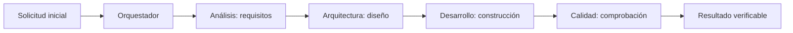
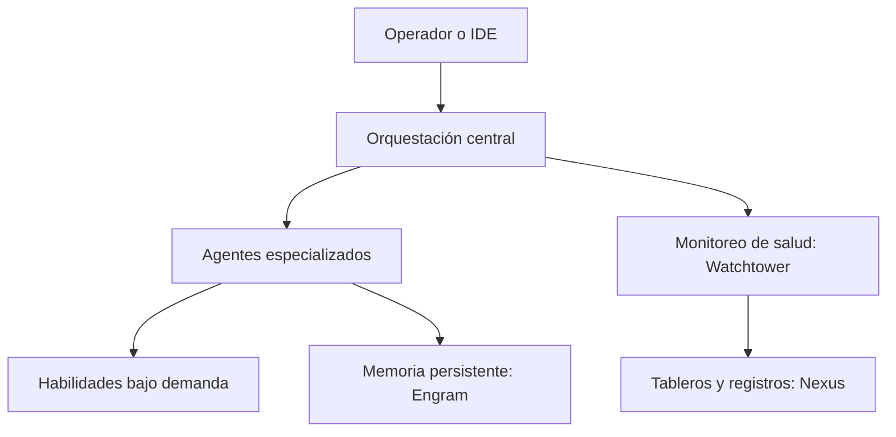

# GentleVanguard

<p align="center">
  
</p>

<p align="center">
  
  
  
</p>

<p align="center"><strong>Capa local-first de orquestación, memoria y verificación para equipos que desarrollan con asistentes de IA.</strong></p>

<p align="center">
  <strong>Versión 4.4.0</strong> (Licencia MIT) · <a href="https://gentlevanguard.github.io/">Sitio institucional</a> · <a href="https://gentlevanguard.github.io/academy/">Academia técnica</a> · <a href="demos/README.md">Guías prácticas</a>
</p>

---

## El problema que resuelve

El desarrollo con asistentes de código presenta fricciones comunes al escalar en proyectos reales:

- **Pérdida de contexto:** cada sesión comienza desde cero; decisiones técnicas, restricciones y
  acuerdos previos se pierden al reiniciar el entorno o alternar entre herramientas.
- **Calidad dispar:** la misma instrucción produce resultados dispares según el modelo y el momento,
  sin validación continua de las reglas del proyecto.
- **Deriva arquitectónica:** se introducen cambios sin revisión que acumulan deuda técnica invisible
  en la base de código.
- **Costos y consumo opacos:** el gasto de tokens, reintentos y tiempo de ejecución queda disperso
  en el historial del chat.

Herramientas como Cursor, Claude Code, Codex y Copilot escriben código. **GentleVanguard aporta la
estructura que les falta:** orquestación de tareas, memoria persistente, puertas de calidad
independientes y observabilidad en tiempo real, operando de forma 100% local en tu máquina.

---

## Qué aporta al flujo de trabajo

| Capacidad                         | Beneficio concreto                                                                                                                                                                                                                                                               |
| --------------------------------- | -------------------------------------------------------------------------------------------------------------------------------------------------------------------------------------------------------------------------------------------------------------------------------- |
| **Orquestación de tareas**        | Cada requerimiento se asigna a un agente especialista (análisis, arquitectura, desarrollo, calidad, operaciones o gobernanza). El trabajo directo en línea (inline-first) es la vía habitual; las especificaciones formales (SDD) se activan a demanda en cambios estructurales. |
| **Memoria técnica persistente**   | Decisiones, contexto del proyecto e historial técnico persisten entre sesiones y herramientas. Una sesión nueva retoma con precisión donde cerró la anterior.                                                                                                                    |
| **Gobernanza y verificación**     | 154 controles automáticos de salud, puertas independientes de revisión, auditoría de dependencias y contratos explícitos entre fases. La calidad se verifica con evidencia, no se presupone.                                                                                     |
| **Observabilidad en tiempo real** | Sesiones, consumo de tokens, tiempos de respuesta, costos estimados y tasas de éxito se registran en una base local como datos medibles.                                                                                                                                         |

---

## Demostraciones prácticas

El directorio [`demos/`](demos/README.md) contiene 8 recorridos paso a paso orientados a diferentes
roles, con comandos reales y salidas esperadas:

| Demostración                                                                          | Audiencia        | Enfoque principal                                               |
| ------------------------------------------------------------------------------------- | ---------------- | --------------------------------------------------------------- |
| [01 — Incorporación al equipo](demos/01-dev-developer-onboarding/DEMO.md)             | Desarrolladores  | Primera sesión, hooks de Git y comandos básicos de CLI          |
| [03 — Memoria y continuidad](demos/03-dev-engram-memory-and-continuity/DEMO.md)       | Desarrolladores  | Memoria persistente y traspaso de contexto entre sesiones       |
| [04 — Puertas de calidad y auditoría](demos/04-dev-quality-gate-review-audit/DEMO.md) | Líderes técnicos | Puertas de control, auditorías y revisión técnica independiente |
| [06 — Visión ejecutiva](demos/06-exec-executive-overview/DEMO.md)                     | Dirección        | Impacto operativo, indicadores de rendimiento y tableros        |

Para acceder al catálogo completo, consulte [`demos/README.md`](demos/README.md).

---

## Cómo funciona

El ciclo de ejecución es directo y estructurado: entender, diseñar, construir y comprobar.



A nivel interno, una arquitectura modular conecta los componentes clave del sistema:



La documentación técnica ampliada, esquemas y contratos están disponibles en
[`docs/technical/STACK-DOCUMENTATION.md`](docs/technical/STACK-DOCUMENTATION.md).

---

## Inicio rápido

Requisitos: Node.js 22.18+ (24 LTS recomendado), pnpm 11+ y Git. Compatible con Windows, macOS y
Linux.

### Instalador para Windows

Descargue **Gentle-Vanguard-Setup-4.4.0.exe** y su archivo de comprobación `.sha256` desde el
[Release oficial v4.4.0](https://github.com/EmmanuelOrtiz87/gentle-vanguard-public/releases/tag/v4.4.0).

El instalador es un preparador de entorno (bootstrapper) de código abierto; no incluye binarios
firmados comercialmente, por lo que Windows SmartScreen puede solicitar confirmación al ejecutar.

Para verificar la integridad del archivo antes de instalar:

```powershell
Get-FileHash .\Gentle-Vanguard-Setup-4.4.0.exe -Algorithm SHA256
# Suma esperada: 7e8eb0b1cbb61839350858bed8a51b2474f0917112d4175273b4771a9c00444c
```

### Instalación desde el código fuente

```sh
git clone https://github.com/EmmanuelOrtiz87/gentle-vanguard-public.git
cd gentle-vanguard-public
corepack enable          # Habilita pnpm de forma nativa sin instalaciones globales
npm run setup            # Inicializa prerrequisitos, dependencias, base Nexus y validadores
```

### Inicialización guiada con plan firmado

Permite auditar exactamente qué cambios realizará el sistema antes de escribir en disco. El
asistente realiza un relevamiento en modo sólo lectura, presenta los componentes seleccionados y
firma el plan con un identificador SHA-256:

```sh
npx tsx src/quickstart/quickstart.ts                          # Relevamiento y emisión del plan firmado
npx tsx src/quickstart/quickstart.ts --accept-plan <id-plan>  # Aplica únicamente los cambios aprobados
```

### Puesta en marcha de la sesión

```sh
npm run session:autostart:detached   # Inicia la sesión de trabajo y los procesos de fondo
npm run watchtower:health -- --full  # Ejecuta los 154 controles de salud del entorno
```

---

## Compatibilidad con herramientas de IA

La configuración del stack está formalmente auditada para:

- **OpenCode**
- **Codex**
- **ZCode**
- **MiniMax Code**
- **GitHub Copilot**
- **Antigravity**

El proceso de auditoría valida perfiles de ejecución, instrucciones de sistema, habilidades cargadas
y servidores MCP configurados. Para conocer el detalle por plataforma, consulte la
[matriz de compatibilidad](docs/guides/COMPATIBILITY-MATRIX.md).

---

## Glosario de conceptos

| Concepto                                | Definición técnica                                                                                                                                                  |
| --------------------------------------- | ------------------------------------------------------------------------------------------------------------------------------------------------------------------- |
| **Engram**                              | Sistema de memoria persistente para ingeniería: observaciones, decisiones y contexto operativo almacenados localmente que sobreviven entre sesiones y herramientas. |
| **Nexus**                               | Base de datos operacional local (SQLite) para métricas de consumo, trazas de ejecución, eventos y alertas del sistema.                                              |
| **Watchtower**                          | Monitor de salud continuo: conjunto de 154 controles automatizados que verifican la integridad funcional del stack.                                                 |
| **Autostart de sesión**                 | Comando único que inicializa el entorno operativo: asignación de ID de sesión, memoria, verificadores y servicios en segundo plano.                                 |
| **Puertas de revisión (RDD)**           | Evaluación independiente que audita la evidencia técnica y el nivel de riesgo antes de dar por completado un cambio.                                                |
| **SDD (Desarrollo por especificación)** | Flujo formal optativo (requisitos → diseño → construcción → verificación) para cambios de alto impacto; las tareas habituales operan en modo directo.               |
| **Graphify**                            | Constructor de grafos de conocimiento sobre la base de código y la documentación técnica, utilizado para navegación y análisis de impacto.                          |

---

## Alcance de la distribución pública

Este repositorio contiene el núcleo en TypeScript, las primitivas compartidas de ejecución, los
asistentes de instalación y la documentación técnica curada. Las aplicaciones operativas internas,
proyectos de clientes, contenidos propietarios y registros confidenciales de sesión permanecen
excluidos de la distribución pública. El sitio web institucional y la Academia cuentan con un
despliegue web independiente.

---

## Documentación de referencia

- [Guía de inicio](docs/getting-started/README.md)
- [Arquitectura del sistema](docs/architecture/README.md)
- [Catálogo de demostraciones](demos/README.md)
- [Historial de versiones](CHANGELOG.md)
- [Proceso de publicación](docs/guides/RELEASE-PROCESS.md)

---

## Licencia

Distribuido bajo licencia MIT © 2026 Emmanuel Ortiz. Consulte el archivo [LICENSE](LICENSE) para más
información.
